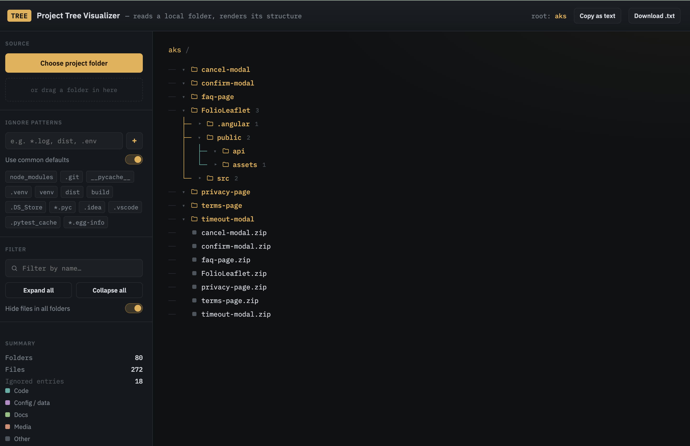

## Project Tree Visualizer

Project Tree Visualizer turns any local folder into a clean, interactive file tree — right in your browser, with nothing ever uploaded. Point it at a project, and it reads every file and subfolder to build a live map of how that codebase is put together.

It's built for developers who want a fast, shareable snapshot of a project's structure. You can:

- **Ignore what you don't need** — common noise like `node_modules`, `.git`, `__pycache__`, and `dist` is filtered out by default, and you can add your own exact-name or wildcard patterns (`*.log`, `.env`).
- **Hide files, keep structure** — collapse files out of a single folder with one click, or hide files everywhere at once, so you can focus purely on how things are organized.
- **Search and navigate** — filter the tree by name, expand or collapse everything instantly, and color-coded dots mark files as code, config, docs, or media at a glance.
- **Export exactly what you see** — copy or download the tree as clean ASCII-style text (`├──`, `└──`) that matches whatever's currently expanded on screen, ready to paste into a README or docs.

No server, no accounts, no data leaving your machine — just a quick way to see, explore, and document the shape of a project.

### Demo — Copy as Text
```bash
aks/
├── cancel-modal/
├── confirm-modal/
├── faq-page/
├── FolioLeaflet/
│   ├── .angular/
│   ├── public/
│   │   ├── api/
│   │   └── assets/
│   └── src/
├── privacy-page/
├── terms-page/
├── timeout-modal/
├── cancel-modal.zip
├── confirm-modal.zip
├── faq-page.zip
├── FolioLeaflet.zip
├── privacy-page.zip
├── terms-page.zip
└── timeout-modal.zip

```

### Demo — UI

